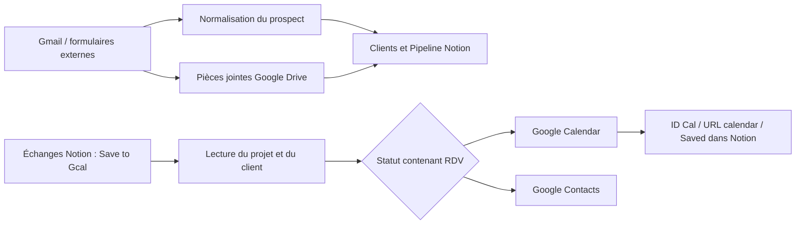

# Automatisations CRM — n8n, Notion & Google

Deux workflows n8n pour centraliser les demandes de prospects dans Notion, puis gérer les rendez-vous et les contacts Google depuis les fiches Notion.

Ce dépôt rassemble les deux étapes d'un même parcours commercial. Les exports ont été nettoyés pour être partagés : **aucune clé API en clair détectée lors de la revue**, références aux credentials retirées, identifiants de configuration remplacés et workflows désactivés. Il faut les configurer avant utilisation.

## Les workflows

| Fichier | Rôle | Déclenchement |
| --- | --- | --- |
| [prospect-to-notion.json](workflows/prospect-to-notion.json) | Centraliser les prospects, créer les clients et les projets Notion, joindre les médias | Webhooks Gmail, Travaux.com, HabitatPresto et Houzz ; déclencheur Gmail présent mais désactivé |
| [notion-to-google-rdv-contacts.json](workflows/notion-to-google-rdv-contacts.json) | Créer ou mettre à jour les rendez-vous et les contacts Google | Recherche dans Notion toutes les minutes, après activation |



### 1. Prospect → Notion

- Le webhook `Bouton Gmail` attend un identifiant de message ; le script ou bouton Gmail qui l'appelle n'est pas fourni.
- Le message est chargé depuis Gmail. Un prospect déjà connu par son e-mail est orienté vers le changement de libellés.
- Pour un nouveau prospect reçu par e-mail, un agent utilise **DeepSeek** pour extraire les coordonnées et les informations du projet.
- Les pièces jointes peuvent être envoyées sur Google Drive ; leurs liens sont regroupés avant écriture dans Notion.
- Les entrées Travaux.com et HabitatPresto rejoignent directement la normalisation. Houzz dispose d'un adaptateur pour son format de texte.
- Le client est recherché par son nom. Le projet est recherché par son URL de plateforme lorsqu'elle est présente. Un nouveau projet reçoit l'étape `Make Contact`.
- Une branche géocode l'adresse avec Nominatim et met à jour la fiche client.

Les nœuds Axonaut et Pennylane sont conservés dans l'export, mais **ils ne sont pas reliés au parcours principal**. Ils constituent des extensions à configurer et à connecter si nécessaire.

### 2. Notion → rendez-vous et contacts Google

- Recherche jusqu'à trois fiches Échanges dont `Google Cal` vaut `Save to Gcal` à chaque passage.
- Charge le premier projet lié, son client et les commentaires de l'échange.
- Un contrôle JavaScript vérifie que le statut contient `RDV`, sans distinction de casse. **Ce workflow n'utilise pas d'IA.**
- Si `ID Cal` est vide, crée un événement ; sinon, met à jour l'événement correspondant dans le calendrier `primary`.
- Prévoit une durée d'une heure lorsque la fin n'est pas renseignée, et des rappels à 24 h, 2 h et 40 min.
- Enregistre l'identifiant et le lien lors de la création, puis passe `Google Cal` à `Saved` après l'action calendrier.
- Recherche les contacts par e-mail pour créer ou mettre à jour leur fiche Google Contacts.

## Installation

1. Télécharger les deux JSON du dossier `workflows/`.
2. Dans n8n, importer chaque fichier via le menu du workflow → **Import from File**. Voir la [documentation officielle d'import/export](https://docs.n8n.io/workflows/export-import/).
3. Garder les workflows désactivés pendant la configuration.
4. Créer les connexions nécessaires dans **Credentials**, puis les sélectionner dans chaque nœud concerné.
5. Remplacer toutes les valeurs `REPLACE_…` ci-dessous et vérifier les propriétés Notion.
6. Tester avec des données fictives et un calendrier de test, puis activer les workflows souhaités.

La version globale de n8n utilisée à l'origine n'est pas indiquée dans les exports. Les versions de chaque nœud sont conservées ; vérifier qu'elles sont disponibles dans votre instance, notamment les nœuds IA et les propriétés Notion de type `place`.

### Connexions à recréer

| Workflow | Credentials requis |
| --- | --- |
| Prospect → Notion | Notion, Gmail OAuth2, Google Drive OAuth2, DeepSeek |
| Extensions non connectées du premier workflow | Pennylane ; authentification HTTP par en-tête pour Axonaut |
| Notion → Google | Notion, Google Calendar OAuth2, Google Contacts OAuth2 |

Les nœuds HTTP Notion doivent également recevoir le credential Notion. Les clés, tokens et autorisations OAuth se configurent dans n8n ; ne pas les écrire dans les fichiers du dépôt.

### Valeurs à remplacer

Ces marqueurs sont des textes à remplacer dans n8n ou dans une copie locale du JSON. Ce ne sont pas des variables d'environnement automatiquement résolues.

| Marqueur | Configuration attendue |
| --- | --- |
| `REPLACE_NOTION_CLIENTS_DATABASE_ID` | Base Clients, pour les recherches et la création |
| `REPLACE_NOTION_PIPELINE_DATABASE_ID` | Base Pipeline / projets |
| `REPLACE_NOTION_ECHANGES_DATABASE_ID` | Base Échanges à synchroniser |
| `REPLACE_GOOGLE_DRIVE_FOLDER_ID` | Dossier de destination des pièces jointes |
| `REPLACE_GMAIL_QUEUE_LABEL_ID` | Identifiant du libellé Gmail à traiter |
| `REPLACE_GMAIL_PROCESSED_LABEL_ID` | Identifiant du libellé Gmail de traitement terminé |
| `REPLACE_GMAIL_WEBHOOK_PATH` | Nouveau chemin du webhook appelé par le bouton Gmail |
| `REPLACE_TRAVAUX_WEBHOOK_PATH` | Nouveau chemin d'entrée Travaux.com |
| `REPLACE_HABITATPRESTO_WEBHOOK_PATH` | Nouveau chemin d'entrée HabitatPresto |
| `REPLACE_HOUZZ_WEBHOOK_PATH` | Nouveau chemin d'entrée Houzz |

Après changement des chemins, reporter les URL générées par votre instance n8n dans les outils appelants. Les scrapers externes ne sont pas inclus.

### Structure Notion attendue

Les expressions dépendent des noms exacts des propriétés et des relations. Partager les bases concernées avec l'intégration Notion et adapter les mappings à votre modèle.

| Base | Propriétés utilisées |
| --- | --- |
| Clients | `Nom` (titre), `Email Facturation` (e-mail), `Mobile Facturation` (téléphone), `Canal de provenance` (sélection), `Autre(s) Information(s)` (texte), `Adresse Facturation` (place), `Contact(s) Lié(s)` (relation) |
| Pipeline / projets | `Nom du projet` (titre), `Brief` (texte), `Client` (relation), `Type de projet` (texte), `URL plateforme ` (URL, **avec un espace final**), `Fichiers et médias` (fichiers), `Étape` (statut avec `Make Contact`), `Livraison` (place), `Accès au chantier` (texte) |
| Échanges | Titre de la fiche ; propriétés produisant `property_projet_s_li_s`, `property_statut`, `property_date`, `property_brief`, `property_t_l_phone` ; `Google Cal` (sélection : `Save to Gcal`, `Saved`), `ID Cal` (texte), `URL calendar` (URL) |
| Contacts liés | Propriétés produisant `property_nom`, `property_email`, `property_phone_number`, `property_email_facturation`, `property_mobile_facturation`, `property_adresse`, `property_adresse_facturation`, `property_observations` |

Pour les propriétés lues via la sortie simplifiée de n8n, les noms techniques ci-dessus sont ceux présents dans les expressions. Vérifier la sortie réelle de vos nœuds Notion avant de continuer : les libellés d'origine ne peuvent pas tous être reconstruits avec certitude à partir de l'export.

## Exemples d'entrées

Corps JSON du webhook Gmail, avec un identifiant de message provenant de votre compte :

```json
{"messageId": "REPLACE_GMAIL_MESSAGE_ID"}
```

Exemple fictif pour une entrée normalisée Travaux.com / HabitatPresto :

```json
{
  "nom": "Client Exemple",
  "email": "client@example.com",
  "telephone": "",
  "localisation": "Paris",
  "URL plateforme": "https://example.com/projets/demo",
  "description": "Demande de devis pour un dressing",
  "provenance": "HabitatPresto",
  "Type de projet": "Dressing",
  "joints": ""
}
```

L'entrée Houzz attend notamment `contactClean`, `infoProjetClean`, `typeProjetClean`, `adresseClean` et `activeTabUrl`, avec `##BR##` comme séparateur de lignes.

## Points à vérifier avant activation

Ces exports conservent la logique source. Le nettoyage pour publication ne constitue pas une correction fonctionnelle complète.

- **Partage Drive** : `Share file` configure un accès `anyone / reader` avec `allowFileDiscovery: true`. Adapter ce partage avant de traiter des pièces jointes de clients.
- **Webhooks** : aucune authentification n'est configurée dans les nœuds d'entrée exportés. Ajouter la protection adaptée avant de les exposer.
- **Chemins Gmail et scrapers** : plusieurs branches de fin appellent les nœuds de libellés Gmail et font référence à `Get a message`. Tester séparément les entrées scraper, où ce nœud n'a pas forcément été exécuté.
- **Expressions et champs vides** : la formule `liens_fichiers` commence par `=={{` dans la source ; certaines expressions accèdent directement à `[0]` ou à une relation. Vérifier le résultat avec et sans fichiers, commentaires, adresse et relations.
- **Contacts** : le câblage `Merge` / contacts liés et le cas d'un client sans contact lié demandent un essai dédié.
- **Doublons et reprise** : le nom du client, l'URL du projet, l'e-mail du contact et `ID Cal` servent de repères. Tester une seconde exécution et une reprise après erreur ; la présence de ces contrôles ne garantit pas l'absence de doublons.
- **Notes internes** : certaines notes conservées parlent encore de Gemini, d'Axonaut ou d'un marquage Gmail « lu ». Les nœuds actuels utilisent DeepSeek pour le premier workflow et changent des libellés Gmail ; le second décide du RDV en JavaScript.
- **Services externes** : le contenu des e-mails est envoyé au modèle IA et les adresses à Nominatim lorsque ces branches s'exécutent. Configurer ces services selon votre usage.

## Vérifications de publication

La revue couvre les deux exports : paramètres, URL, en-têtes, corps HTTP, code JavaScript et métadonnées. Les noms et identifiants de **32 associations de credentials** ont été retirés ; les identifiants de bases, dossier Drive, libellés et chemins de webhooks ont été remplacés. Les métadonnées d'instance et identifiants globaux des workflows ont été supprimés. Les données épinglées sont vides.

Le contrôle local vérifie les JSON, les connexions entre nœuds et l'absence des principaux formats de secrets :

```sh
python scripts/check_workflows.py
```

Ce contrôle est statique et ne détecte pas tous les formats possibles de secrets. Aucun workflow n'a été exécuté contre les comptes de production lors de cette préparation. Les fichiers source restent inchangés ; seuls les exports nettoyés sont publiés.
